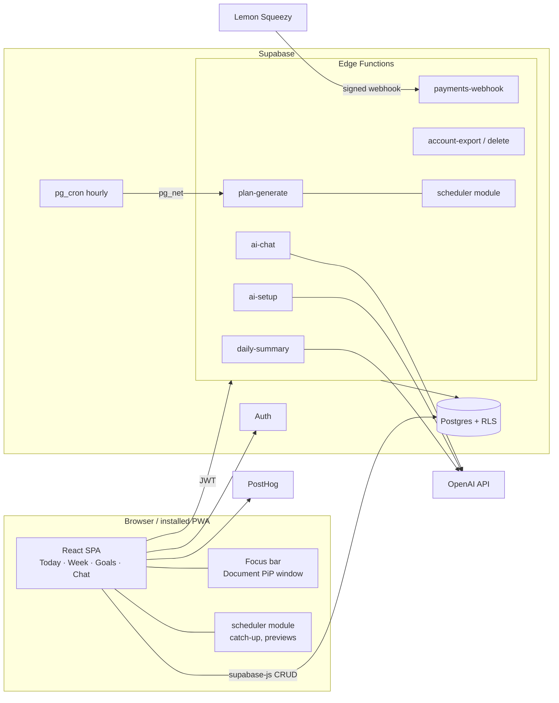

# System Design: Kutitap Phase 1 (PWA beta)

**Companion to:** PRD.md (v3.3), VALIDATION.md
**Last updated:** 2026-11-25
**Scope:** Phase 1 MVP only. Phase 2 (Tauri) is noted where it changes a decision today.

---

## 1. Design principles

1. **One person builds and runs this, part time, on ~$100-150.** Prefer managed services with free tiers and as few moving parts as possible: no own servers, no queue, no microservices.
2. **The scheduler is deterministic code; AI only turns text into structured data** (PRD §11, §13). AI never writes to the database directly.
3. **Nothing changes without a preview** (F2.2, F7.3). AI output is a *proposal*; the user confirms; then it is applied.
4. **Everything time-related is computed from stored timestamps** (timer end time, block start/end), never from a running counter.
5. **Same frontend moves to Tauri in Phase 2**, so the app is a static SPA with no server-side rendering.

---

## 2. Stack

| Layer | Choice | Why |
|---|---|---|
| Landing page | Existing static `index.html` | Already built. Waitlist form posts to Supabase (§9). |
| App frontend | **Vite + React + TypeScript + Tailwind** | Static SPA, drops straight into Tauri 2. Next.js adds SSR that Tauri can't use. |
| Routing | React Router | 3 screens + settings + onboarding; nothing fancier needed. |
| Server state | **TanStack Query** over `supabase-js` | Caching, refetch on window focus (cheap cross-device sync), optimistic updates for Done/Skip. |
| Validation | **Zod** | One schema per AI job, shared by client and Edge Functions. |
| Timeline UI | Custom component (CSS grid, 15-min rows) | Day timeline + read-only week view are simple. FullCalendar is heavy and fights the design tokens. |
| PWA | `vite-plugin-pwa` (Workbox) | Manifest + service worker that caches the app shell only (offline is a non-goal). |
| Floating focus bar | Document Picture-in-Picture API | Fallback: in-app focus view (Safari, Firefox < 151). |
| Auth | Supabase Auth: email magic link + Google | No passwords to manage. |
| Database | Supabase Postgres, **RLS on every table** | Client talks to the DB directly for plain CRUD. |
| Server logic | **Supabase Edge Functions** (Deno, TypeScript) | AI calls, plan generation, webhooks, account export/delete. |
| Scheduled jobs | **pg_cron + pg_net** (built into Supabase) | One hourly job fans out per-timezone work (§6). |
| AI | OpenAI API, called only from Edge Functions | Structured outputs (JSON schema), model routing per PRD §13. |
| Notifications | Browser Notification API + in-app sound | While app is open/minimized. Web Push is v1.1. |
| Payments | Lemon Squeezy payment link + webhook | Merchant of record handles global tax and refunds. |
| Hosting | **Vercel** (landing + app, two projects) | Familiar, preview deploys per branch, static SPA needs only an SPA rewrite in `vercel.json`. Hobby plan is non-commercial: move to Pro ($20/mo) before taking Founding Member payments. |
| Analytics | PostHog (cloud, free tier) | Activation/retention events in §10. |
| Errors | Sentry (free tier) | Client + Edge Functions. |
| Tests | Vitest | Scheduler unit tests + AI parsing eval set (§11). |

**Domains:** `getkutitap.com` (landing), `app.getkutitap.com` (PWA). Separate origins keep the PWA's scope and service worker clean.

---

## 3. Architecture



**The scheduler is one pure TypeScript module** (no I/O, no Deno or browser APIs) at `supabase/functions/_shared/scheduler/`. Edge Functions import it directly; the Vite app imports the same files through a path alias. That way:
- the nightly/weekly plan is generated server-side (ready before first open, F5.2),
- catch-up runs instantly on the client after a check-in, with no network round-trip and no AI call (PRD §13 cost control),
- both produce identical results because it is the same code.

---

## 4. Repo layout

```
landing/            index.html + assets (current files move here)
app/                Vite React PWA
  src/screens/      Today, Week, Goals, Onboarding, Settings, Summary
  src/focus/        focus bar (PiP + fallback), timer, check-ins
  src/chat/         chat box + proposal preview
supabase/
  migrations/       SQL: tables, RLS policies, cron jobs
  functions/
    _shared/scheduler/   pure planning engine (+ tests)
    _shared/ai/          OpenAI client, prompts, Zod schemas, usage logging
    ai-chat/ ai-setup/ plan-generate/ daily-summary/
    payments-webhook/ account-export/ account-delete/ waitlist/
docs/
```

No monorepo tooling (Turborepo, workspaces): one alias is enough to share the scheduler.

---

## 5. Data model

Based on PRD §12 with these changes (marked **Δ**):

```sql
profiles        id (= auth.users.id), timezone, wake_time, sleep_time,
                deep_work_pref [morning|afternoon|evening],
                pomodoro jsonb, someday_block_minutes, weekly_draft_dow/time,
                Δ plan [free|pro|founding], Δ trial_ends_at, Δ onboarded_at
goals           id, user_id, title, year, status, color
fixed_blocks    id, user_id, title, days_of_week int[], start_time, end_time (local),
                location, source [text|manual], valid_from, valid_to
block_exceptions id, Δ user_id, fixed_block_id, date, type [skip|change], new_start, new_end
tasks           id, user_id, goal_id, parent_task_id, title,
                type [deadline|someday|recurring], recurrence jsonb, preferred_period,
                est_minutes, due_at, soft_due_at, energy [deep|light], status,
                trigger_text, Δ last_progress_at, Δ skip_count, created_at
plan_blocks     id, Δ user_id, date, ref_type [task|fixed|break|buffer], ref_id,
                start_at, end_at, status [pending|done|partial|skipped|moved],
                Δ source [weekly|daily|catchup|manual]
check_ins       id, Δ user_id, plan_block_id, answer [done|more_time|partial|skipped],
                extra_minutes, answered_at
focus_sessions  id, user_id, plan_block_id, started_at, ends_at, ended_at, completed
daily_summaries id, user_id, date, stats jsonb, note
chat_messages   id, user_id, role, content, Δ proposal jsonb,
                Δ proposal_status [none|pending|applied|rejected], created_at
Δ ai_usage      user_id, day, job, calls, tokens_in, tokens_out      (PK user_id, day, job)
Δ waitlist      email (unique), headline_variant, source, created_at
```

**Why the changes:**
- **`days_waiting` is not stored**; it is `now() - coalesce(last_progress_at, created_at)`. A stored counter needs a job to keep it right.
- **`week_plans` is dropped.** The weekly draft simply writes a week of `plan_blocks` (`source = weekly`). Nothing in the MVP needs the week as its own row; add it back with the v1.1 weekly review screen.
- **`user_id` on every child table** so each RLS policy is the same one-liner (`user_id = auth.uid()`), with no joins.
- **`recurrence` as small JSON** (`{"per_week": 4}`, `{"days": [1,3,5]}`, `{"daily": true}`) instead of iCal RRULE: covers F8.1 and is trivial to evaluate.
- **`skip_count`** drives F6.5 (after 3 skips, ask: shrink, reschedule or drop).
- **Entitlements live on `profiles`** (`plan`, `trial_ends_at`); users cannot write those two columns (column-level grant; only the service role can).
- **`ai_usage`** enforces per-user caps and logs cost per job (PRD §13).

**Time rules:** all instants are `timestamptz`. Fixed blocks store *local* wall-clock times + weekday, expanded to instants using `profiles.timezone` when a day is planned (so DST is handled once, in one place). `plan_blocks.date` is the user's local date.

Indexes: `plan_blocks (user_id, date)`, `tasks (user_id, status)`, `chat_messages (user_id, created_at desc)`.

---

## 6. Scheduled jobs

One pg_cron job, **every hour on the hour**, calls `plan-generate` with `{mode: "tick"}`. The function selects users whose *local* time is in the hour that needs work:

| Local time | Work |
|---|---|
| Sunday, `weekly_draft_time` (default 19:00) | Weekly draft for next week (PRD §11 steps 1-6) |
| 04:00 daily | Today's plan: slice of weekly plan + carry-overs, re-checked for load (F5.2) |
| Evening summary time | Pre-compute `daily_summaries.stats` (AI text generated when opened) |

Processed in batches of ~50 users per invocation (Edge Function time limits); the tick records progress so a timeout resumes on the next call.

**Safety net:** the client calls `plan-generate {mode: "ensure", date: today}` when Today opens. It is **idempotent**: if today already has blocks, it returns them. So a missed or failed cron run costs the user nothing; they never see an empty day.

---

## 7. Key flows

### 7.1 AI proposal → preview → apply (chat, setup, goals)

```
user text ──► ai-chat (Edge Function)
               1. auth + plan check + ai_usage cap
               2. send text + minimal context (today's blocks, task titles, goal titles,
                  timezone, now) to the routed model with a JSON schema
               3. Zod-validate the result into an op list:
                  create_task | update_task | delete_task | add_fixed_block |
                  add_exception | move_block | replan_day | answer (question only)
               4. run the scheduler in dry-run to place new/moved items
               5. store as chat_messages.proposal (status pending), return preview
user taps OK ──► ai-chat {action: "apply", message_id}
               re-validate ops, apply in one transaction, status = applied
```

- Questions ("When am I free this week?") are answered from the DB by the scheduler, not by the model; the model only classifies the intent.
- The model never sees other users' data and never receives an id it could abuse; ops reference rows by short index into the context sent with the request, mapped back server-side.
- **Small catch-up changes skip the confirm step** (F11.3); everything from chat is confirmed.

`ai-setup` follows the same pattern for onboarding: text → `fixed_blocks` + flags on unclear parts (F2.3) → week preview → confirm → save.

### 7.2 Focus session and check-in (client-side)

1. **Start** inserts `focus_sessions` with `ends_at = now + duration` and opens the PiP window (user gesture required).
2. The timer renders `ends_at - Date.now()` every second, so sleep/minimize can't drift it (F9.2). On wake, `visibilitychange` re-renders immediately.
3. At `ends_at`: sound + Notification (if not focused) + check-in card in the PiP window.
4. Answer writes `check_ins`, updates `plan_blocks.status`, `tasks.last_progress_at` / `skip_count`, and runs **catch-up in the client scheduler**. Small diffs are written with a toast ("Okay lang, I moved it to tomorrow"); big diffs (> 1 block moved to another day, or > 60 min shifted) show a confirm.
5. Ignored check-in: shown once more at the next break, then left alone (F10.3).

Actual durations from `focus_sessions` + `check_ins` feed a per-user estimate factor (median actual/estimated over the last 20 tasks) used by the scheduler (F9.4, F10.4). Plain statistics, no AI.

### 7.3 Daily summary

Stats are computed by SQL (blocks done, focused minutes, goal/someday progress, habit counts). One cheap model call turns the stats into 2-3 warm lines in the Titap tone; if the call fails or the cap is hit, a template string is used. The summary never depends on AI to show.

### 7.4 Payments

Payment link carries the user's id as custom data → Lemon Squeezy webhook → `payments-webhook` verifies the HMAC signature, is idempotent on order id, sets `profiles.plan = founding`. Refunds flip it back.

---

## 8. Scheduler engine (the core)

Pure function, fully unit-tested:

```ts
plan(input: {
  profile, fixedBlocks, exceptions, tasks, existingBlocks, history,
  range: { from: Date, to: Date }, now: Date, mode: 'week' | 'day' | 'catchup'
}): { blocks: PlanBlock[], changes: Change[], warnings: string[] }
```

- Builds free intervals per day: wake→sleep minus fixed blocks minus exceptions.
- Places in PRD §11 order: fixed recurring tasks → deadline tasks by `est/minutes_until_due` → Big Rocks (goal + someday, top `someday_score`, one per weekday minimum, deep-work slot) → flexible habits → the rest.
- Reserves 10-15% buffer per day and a break after each focus block; never exceeds free time.
- Chunks anything longer than the slot into follow-up tasks (AI chunking names them; the engine only needs sizes).
- Catch-up applies F11.2 in order and reports a `changes` list so the UI can decide auto vs ask.

### Worked example (one weekday)

Same inputs always produce the same schedule: AI only turned the user's text into structured tasks beforehand.

**1. Free time.** Wake 6:00, sleep 23:00; fixed commute 6:00-8:00 and work 8:00-17:00 → free 17:00-23:00 = 360 min.

**2. Budget.** Reserve ~15% buffer (~54 min) → ~306 min schedulable, including a 5-min break after each focus block.

**3. Fill by priority**, each tier taking only what the tiers above left:

| Order | What | How it picks a slot |
|---|---|---|
| 1 | Fixed-time habits ("Gym 18:00") | Exactly at their time |
| 2 | Deadline tasks | By `urgency = est_minutes / minutes_until_due` |
| 3 | Big Rocks (goal + someday) | Top `someday_score`, in the deep-work slot, ≥1 per weekday |
| 4 | Flexible habits ("4x a week, evenings") | First fitting gap in their preferred period |
| 5 | Everything else | Remaining gaps until the budget is spent |

Placement is "earliest gap that fits within the preferred period"; too big for one gap → split; no room → rolls to tomorrow.

**4. Personal estimate factor.** If the user's median actual/estimated ratio is 1.4, a "60 min" task gets 84 min.

**Result:**
```
17:00  Gym (fixed habit)            60
18:00  break                         5
18:05  Update résumé (goal, someday) 60   ← Big Rock, waiting 12 days
19:05  break                         5
19:10  Study for exam (due Fri)      90   ← deadline
20:40  break                         5
20:45  Reply to client emails        45
21:30  buffer (unscheduled)          ~90
```

**Week vs day vs catch-up:** the weekly draft runs the same steps over 7 days (a task is placed once, so Big Rocks spread out). The 4 AM daily run takes today's slice plus carry-overs and re-runs steps 1-4 on today. Catch-up re-runs on the rest of today with F11.2 rules (fixed and due-today blocks locked, buffer used first, shrink before move, never cram) and returns a `changes` list the UI uses to decide auto-apply vs ask.

`size_weight` and `goal_link_bonus` are not set by the PRD: start with simple defaults and tune from concierge-test data.

**Acceptance tests** (Vitest) encode the PRD acceptance criteria directly: every active someday task gets ≥1 block per week; planned time ≤ free time − buffer; nothing after sleep time; fixed blocks and same-day deadlines never move in catch-up.

---

## 9. Security and privacy

- **RLS on every table**, default deny; policy `user_id = auth.uid()`. A CI check fails if a table has RLS disabled.
- OpenAI key and Lemon Squeezy secret exist only as Edge Function secrets.
- AI output is untrusted: schema-validated, ops limited to the caller's rows, max ops per proposal.
- Per-user caps in `ai_usage` (free: e.g. 20 chat calls/day; Pro: fair-use ceiling), plus a monthly spending cap on the OpenAI account.
- Only the needed text is sent to the model (no email, no names beyond what the user typed).
- **Waitlist form** posts to a `waitlist` Edge Function (rate-limited, email validated, honeypot field), not to the table with the anon key, so the table isn't open to bulk inserts.
- **Export and delete from day one** (PRD §14): `account-export` returns a JSON of all the user's rows; `account-delete` deletes `auth.users` (rows cascade).

---

## 10. Observability and metrics

- `ai_usage` gives cost per user per job daily (SQL view).
- PostHog events map 1:1 to PRD §16 and VALIDATION checkpoints: `signup`, `onboarding_completed {seconds}`, `setup_accepted {edits}`, `plan_viewed`, `block_started {seconds_since_open}`, `checkin_answered {answer}`, `someday_block_done`, `summary_viewed`, `pmf_answer`, `trial_choice`, `purchase`.
- Sentry on client and functions; Supabase logs for cron runs.

---

## 11. AI quality: eval set

`supabase/functions/_shared/ai/evals/` holds ~50 real-style inputs per job (schedule descriptions in English and Taglish, chat commands) with expected structured output. `npm run eval` runs them against the configured model and reports pass rate. This is how the **90% schedule-parsing acceptance** (F2.1) is measured, and how a model swap (e.g. to a cheaper one) is checked before shipping.

---

## 12. Build order (maps to PRD §19)

| Week | System work |
|---|---|
| 1 | Supabase project, migrations + RLS, auth, PWA shell, `ai-setup` + preview, Today timeline from fixed blocks. Waitlist function live on landing page. |
| 2 | `ai-chat` propose/apply, tasks + recurrence, scheduler: day placement + someday scoring |
| 3 | Scheduler: weekly draft; `plan-generate` + pg_cron + ensure-on-open; Goals screen; Week view |
| 4 | Focus bar (PiP + fallback), timer, check-ins, client-side catch-up |
| 5 | Daily summary, onboarding + startup guide, trial/plan limits, payment webhook, export/delete, analytics events |

---

## 13. Phase 2 hooks (decided now, built later)

- SPA is static → Tauri 2 wraps `app/dist` unchanged.
- Notifications, auto-start and the floating window sit behind one small `platform` module (`notify`, `openFocusWindow`, `onWake`) with a web implementation now and a Tauri one later. Nothing else in the app calls browser APIs for these directly.
- Blocking/usage tracking will be on-device in Tauri; nothing in this design sends that data to the server.

---

## 14. Open technical questions

1. **Model names and prices** in PRD §13 must be confirmed on OpenAI's pricing page before week 2; the router reads model ids from env vars so a swap is config only.
2. **pg_cron fan-out** is fine to a few thousand users; beyond that move per-user jobs to a queue (Supabase Queues). Not needed for the beta.
3. **Cross-device live sync:** refetch-on-focus covers laptop + phone for the beta. Add Supabase Realtime on `plan_blocks` only if testers hit stale views.
4. **Week starts Sunday or Monday?** Affects weekly draft timing (PRD open question 3); store as a profile setting either way.
